<!-- Generated by scripts/build-profile.mjs. Edit the source to refresh the profile cards. -->

<a href="https://vishvadharman-portfolio.vercel.app/?build=1">
  <picture>
    <source media="(prefers-reduced-motion: reduce)" srcset="assets/portfolio-cover.png">
    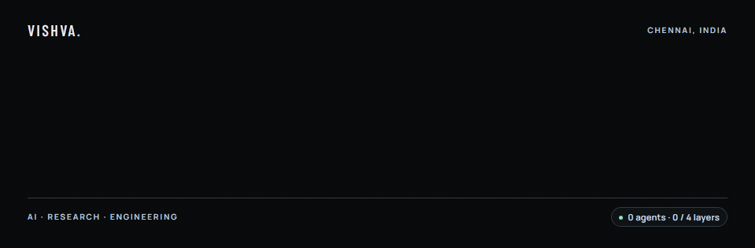
  </picture>
</a>

<picture>
  <source media="(prefers-reduced-motion: reduce) and (max-width: 767px)" srcset="assets/field-console-mobile-still.png">
  <source media="(prefers-reduced-motion: reduce)" srcset="assets/field-console-still.png">
  <source media="(max-width: 767px)" srcset="assets/field-console-mobile.gif">
  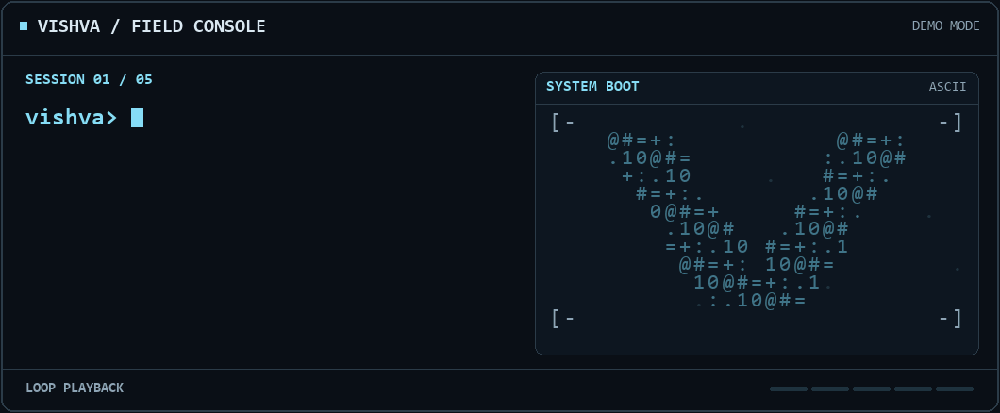
</picture>

<a href="https://vishvadharman-portfolio.vercel.app/?build=1"><picture><source media="(max-width: 767px)" srcset="assets/profile-motion/portfolio-mobile.svg"></picture></a> <a href="https://www.linkedin.com/in/vishvasami23/"><picture><source media="(max-width: 767px)" srcset="assets/profile-motion/linkedin-mobile.svg"></picture></a> <a href="mailto:vishvadharmansaminathan@gmail.com"><picture><source media="(max-width: 767px)" srcset="assets/profile-motion/email-mobile.svg"></picture></a>

<a href="https://vishvadharman-portfolio.vercel.app/#about"><picture><source media="(prefers-reduced-motion: reduce) and (max-width: 767px)" srcset="assets/profile-motion/intro-mobile-still.svg"><source media="(prefers-reduced-motion: reduce)" srcset="assets/profile-motion/intro-still.svg"><source media="(max-width: 767px)" srcset="assets/profile-motion/intro-mobile.svg"></picture></a>

<picture><source media="(prefers-reduced-motion: reduce) and (max-width: 767px)" srcset="assets/profile-motion/work-mobile-still.svg"><source media="(prefers-reduced-motion: reduce)" srcset="assets/profile-motion/work-still.svg"><source media="(max-width: 767px)" srcset="assets/profile-motion/work-mobile.svg"></picture>

<a href="https://deviation-ai-review.vercel.app/"><picture><source media="(prefers-reduced-motion: reduce) and (max-width: 767px)" srcset="assets/profile-motion/deviation-mobile-still.svg"><source media="(prefers-reduced-motion: reduce)" srcset="assets/profile-motion/deviation-still.svg"><source media="(max-width: 767px)" srcset="assets/profile-motion/deviation-mobile.svg"></picture></a>

<a href="https://github.com/Vishvadharman/Hippocamp-AI"><picture><source media="(prefers-reduced-motion: reduce) and (max-width: 767px)" srcset="assets/profile-motion/brainvault-mobile-still.svg"><source media="(prefers-reduced-motion: reduce)" srcset="assets/profile-motion/brainvault-still.svg"><source media="(max-width: 767px)" srcset="assets/profile-motion/brainvault-mobile.svg"></picture></a>

<a href="https://vishvadharman-portfolio.vercel.app/#work"><picture><source media="(prefers-reduced-motion: reduce) and (max-width: 767px)" srcset="assets/profile-motion/kavach-mobile-still.svg"><source media="(prefers-reduced-motion: reduce)" srcset="assets/profile-motion/kavach-still.svg"><source media="(max-width: 767px)" srcset="assets/profile-motion/kavach-mobile.svg"></picture></a>

<a href="https://github.com/Vishvadharman/Wall_Crack_Detection"><picture><source media="(prefers-reduced-motion: reduce) and (max-width: 767px)" srcset="assets/profile-motion/wall-crack-mobile-still.svg"><source media="(prefers-reduced-motion: reduce)" srcset="assets/profile-motion/wall-crack-still.svg"><source media="(max-width: 767px)" srcset="assets/profile-motion/wall-crack-mobile.svg"></picture></a>

<picture><source media="(prefers-reduced-motion: reduce) and (max-width: 767px)" srcset="assets/profile-motion/research-mobile-still.svg"><source media="(prefers-reduced-motion: reduce)" srcset="assets/profile-motion/research-still.svg"><source media="(max-width: 767px)" srcset="assets/profile-motion/research-mobile.svg"></picture>

<a href="https://doi.org/10.32604/cmes.2026.086802"><picture><source media="(prefers-reduced-motion: reduce) and (max-width: 767px)" srcset="assets/profile-motion/v2x-mobile-still.svg"><source media="(prefers-reduced-motion: reduce)" srcset="assets/profile-motion/v2x-still.svg"><source media="(max-width: 767px)" srcset="assets/profile-motion/v2x-mobile.svg"></picture></a>

<a href="https://vishvadharman-portfolio.vercel.app/#research"><picture><source media="(prefers-reduced-motion: reduce) and (max-width: 767px)" srcset="assets/profile-motion/accepted-papers-mobile-still.svg"><source media="(prefers-reduced-motion: reduce)" srcset="assets/profile-motion/accepted-papers-still.svg"><source media="(max-width: 767px)" srcset="assets/profile-motion/accepted-papers-mobile.svg"></picture></a>

<a href="https://vishvadharman-portfolio.vercel.app/#research"><picture><source media="(prefers-reduced-motion: reduce) and (max-width: 767px)" srcset="assets/profile-motion/patent-applications-mobile-still.svg"><source media="(prefers-reduced-motion: reduce)" srcset="assets/profile-motion/patent-applications-still.svg"><source media="(max-width: 767px)" srcset="assets/profile-motion/patent-applications-mobile.svg"></picture></a>

<picture><source media="(prefers-reduced-motion: reduce) and (max-width: 767px)" srcset="assets/profile-motion/open-source-mobile-still.svg"><source media="(prefers-reduced-motion: reduce)" srcset="assets/profile-motion/open-source-still.svg"><source media="(max-width: 767px)" srcset="assets/profile-motion/open-source-mobile.svg"></picture>

<a href="https://github.com/JhaSourav07/commitpulse/pull/1853"><picture><source media="(prefers-reduced-motion: reduce) and (max-width: 767px)" srcset="assets/profile-motion/commitpulse-mobile-still.svg"><source media="(prefers-reduced-motion: reduce)" srcset="assets/profile-motion/commitpulse-still.svg"><source media="(max-width: 767px)" srcset="assets/profile-motion/commitpulse-mobile.svg"></picture></a>

<a href="https://github.com/utksh1/SecuScan/pull/779"><picture><source media="(prefers-reduced-motion: reduce) and (max-width: 767px)" srcset="assets/profile-motion/secuscan-mobile-still.svg"><source media="(prefers-reduced-motion: reduce)" srcset="assets/profile-motion/secuscan-still.svg"><source media="(max-width: 767px)" srcset="assets/profile-motion/secuscan-mobile.svg"></picture></a>

<picture><source media="(prefers-reduced-motion: reduce) and (max-width: 767px)" srcset="assets/profile-motion/toolkit-mobile-still.svg"><source media="(prefers-reduced-motion: reduce)" srcset="assets/profile-motion/toolkit-still.svg"><source media="(max-width: 767px)" srcset="assets/profile-motion/toolkit-mobile.svg"></picture>

<a href="https://github.com/Vishvadharman?tab=overview#js-contribution-activity"><picture><source media="(prefers-reduced-motion: reduce) and (max-width: 767px)" srcset="assets/profile-motion/activity-mobile-still.svg"><source media="(prefers-reduced-motion: reduce)" srcset="assets/profile-motion/activity-still.svg"><source media="(max-width: 767px)" srcset="assets/profile-motion/activity-mobile.svg"></picture></a>

