<!-- Generated by scripts/build-profile.mjs. Edit the source to refresh the cards and text version. -->

<a href="https://vishvadharman-portfolio.vercel.app/?build=1">
  <picture>
    <source media="(prefers-reduced-motion: reduce)" srcset="assets/portfolio-cover.png">
    
  </picture>
</a>

<a href="https://vishvadharman-portfolio.vercel.app/?build=1"><picture><source media="(max-width: 767px)" srcset="assets/dossier/build-signal-mobile.svg"></picture></a>

<a href="https://vishvadharman-portfolio.vercel.app/?build=1"><picture><source media="(max-width: 767px)" srcset="assets/dossier/portfolio-mobile.svg"></picture></a> <a href="https://www.linkedin.com/in/vishvasami23/"><picture><source media="(max-width: 767px)" srcset="assets/dossier/linkedin-mobile.svg"></picture></a> <a href="mailto:vishvadharmansaminathan@gmail.com"><picture><source media="(max-width: 767px)" srcset="assets/dossier/email-mobile.svg"></picture></a>

<a href="https://vishvadharman-portfolio.vercel.app/#about"><picture><source media="(prefers-reduced-motion: reduce) and (max-width: 767px)" srcset="assets/dossier/intro-mobile-still.svg"><source media="(prefers-reduced-motion: reduce)" srcset="assets/dossier/intro-still.svg"><source media="(max-width: 767px)" srcset="assets/dossier/intro-mobile.svg"></picture></a>

<picture><source media="(prefers-reduced-motion: reduce) and (max-width: 767px)" srcset="assets/dossier/work-mobile-still.svg"><source media="(prefers-reduced-motion: reduce)" srcset="assets/dossier/work-still.svg"><source media="(max-width: 767px)" srcset="assets/dossier/work-mobile.svg"></picture>

<a href="https://deviation-ai-review.vercel.app/"><picture><source media="(prefers-reduced-motion: reduce) and (max-width: 767px)" srcset="assets/dossier/deviation-mobile-still.svg"><source media="(prefers-reduced-motion: reduce)" srcset="assets/dossier/deviation-still.svg"><source media="(max-width: 767px)" srcset="assets/dossier/deviation-mobile.svg"></picture></a>

<a href="https://github.com/Vishvadharman/Hippocamp-AI"><picture><source media="(prefers-reduced-motion: reduce) and (max-width: 767px)" srcset="assets/dossier/brainvault-mobile-still.svg"><source media="(prefers-reduced-motion: reduce)" srcset="assets/dossier/brainvault-still.svg"><source media="(max-width: 767px)" srcset="assets/dossier/brainvault-mobile.svg"></picture></a>

<a href="https://vishvadharman-portfolio.vercel.app/#work"><picture><source media="(prefers-reduced-motion: reduce) and (max-width: 767px)" srcset="assets/dossier/kavach-mobile-still.svg"><source media="(prefers-reduced-motion: reduce)" srcset="assets/dossier/kavach-still.svg"><source media="(max-width: 767px)" srcset="assets/dossier/kavach-mobile.svg"></picture></a>

<a href="https://github.com/Vishvadharman/Wall_Crack_Detection"><picture><source media="(prefers-reduced-motion: reduce) and (max-width: 767px)" srcset="assets/dossier/wall-crack-mobile-still.svg"><source media="(prefers-reduced-motion: reduce)" srcset="assets/dossier/wall-crack-still.svg"><source media="(max-width: 767px)" srcset="assets/dossier/wall-crack-mobile.svg"></picture></a>

<picture><source media="(prefers-reduced-motion: reduce) and (max-width: 767px)" srcset="assets/dossier/research-mobile-still.svg"><source media="(prefers-reduced-motion: reduce)" srcset="assets/dossier/research-still.svg"><source media="(max-width: 767px)" srcset="assets/dossier/research-mobile.svg"></picture>

<a href="https://doi.org/10.32604/cmes.2026.086802"><picture><source media="(prefers-reduced-motion: reduce) and (max-width: 767px)" srcset="assets/dossier/v2x-mobile-still.svg"><source media="(prefers-reduced-motion: reduce)" srcset="assets/dossier/v2x-still.svg"><source media="(max-width: 767px)" srcset="assets/dossier/v2x-mobile.svg"></picture></a>

<a href="https://vishvadharman-portfolio.vercel.app/#research"><picture><source media="(prefers-reduced-motion: reduce) and (max-width: 767px)" srcset="assets/dossier/accepted-papers-mobile-still.svg"><source media="(prefers-reduced-motion: reduce)" srcset="assets/dossier/accepted-papers-still.svg"><source media="(max-width: 767px)" srcset="assets/dossier/accepted-papers-mobile.svg"></picture></a>

<a href="https://vishvadharman-portfolio.vercel.app/#research"><picture><source media="(prefers-reduced-motion: reduce) and (max-width: 767px)" srcset="assets/dossier/patent-applications-mobile-still.svg"><source media="(prefers-reduced-motion: reduce)" srcset="assets/dossier/patent-applications-still.svg"><source media="(max-width: 767px)" srcset="assets/dossier/patent-applications-mobile.svg"></picture></a>

<picture><source media="(prefers-reduced-motion: reduce) and (max-width: 767px)" srcset="assets/dossier/open-source-mobile-still.svg"><source media="(prefers-reduced-motion: reduce)" srcset="assets/dossier/open-source-still.svg"><source media="(max-width: 767px)" srcset="assets/dossier/open-source-mobile.svg"></picture>

<a href="https://github.com/JhaSourav07/commitpulse/pull/1853"><picture><source media="(prefers-reduced-motion: reduce) and (max-width: 767px)" srcset="assets/dossier/commitpulse-mobile-still.svg"><source media="(prefers-reduced-motion: reduce)" srcset="assets/dossier/commitpulse-still.svg"><source media="(max-width: 767px)" srcset="assets/dossier/commitpulse-mobile.svg"></picture></a>

<a href="https://github.com/utksh1/SecuScan/pull/779"><picture><source media="(prefers-reduced-motion: reduce) and (max-width: 767px)" srcset="assets/dossier/secuscan-mobile-still.svg"><source media="(prefers-reduced-motion: reduce)" srcset="assets/dossier/secuscan-still.svg"><source media="(max-width: 767px)" srcset="assets/dossier/secuscan-mobile.svg"></picture></a>

<picture><source media="(prefers-reduced-motion: reduce) and (max-width: 767px)" srcset="assets/dossier/toolkit-mobile-still.svg"><source media="(prefers-reduced-motion: reduce)" srcset="assets/dossier/toolkit-still.svg"><source media="(max-width: 767px)" srcset="assets/dossier/toolkit-mobile.svg"></picture>

<a href="https://github.com/Vishvadharman?tab=overview#js-contribution-activity"><picture><source media="(prefers-reduced-motion: reduce) and (max-width: 767px)" srcset="assets/dossier/activity-mobile-still.svg"><source media="(prefers-reduced-motion: reduce)" srcset="assets/dossier/activity-still.svg"><source media="(max-width: 767px)" srcset="assets/dossier/activity-mobile.svg"></picture></a>

Text version and links

**[About me](https://vishvadharman-portfolio.vercel.app/#about)**. I’m in my final year of B.Tech in AI and ML at VIT Chennai. As an AI intern at Mavdero TechServices, I work on document comparison and care about whether a reviewer can trace a flagged change back to the source.

### Selected work

**[DeviationAI](https://deviation-ai-review.vercel.app/)**. Compares legal drafts against a reference and links each finding to the source wording.

**[HippocampAI / BrainVault](https://github.com/Vishvadharman/Hippocamp-AI)**. Our team extended HippocampAI with encrypted memory on a USB drive so an assistant could pick up its context on another machine.

**[KavachFusion](https://vishvadharman-portfolio.vercel.app/#work)**. Connects CAN bus alerts with trust scores from the wider vehicle network.

**[Wall Crack Detection](https://github.com/Vishvadharman/Wall_Crack_Detection)**. Fine-tunes a ResNet-18 classifier on images of walls.

### Research & inventions

**[Federated learning for V2X](https://doi.org/10.32604/cmes.2026.086802)**. We used SUMO traffic simulations to test how a shared accident detector responds to fake vehicle identities and poisoned model updates.

**[Cardiac models & emergency audio](https://vishvadharman-portfolio.vercel.app/#research)**. Two accepted papers on physics-informed models for cardiac electrophysiology and audio-based emergency dispatch.

**[Two published patent applications](https://vishvadharman-portfolio.vercel.app/#research)**. IN202641083839 A1 covers adversarial attacks in federated learning. IN202641086137 A1 covers elevator bio-safety.

### Open source

**[CommitPulse](https://github.com/JhaSourav07/commitpulse/pull/1853)**. I tested the streak calculation against a large spike in one day’s commits.

**[SecuScan](https://github.com/utksh1/SecuScan/pull/779)**. I added parser and contract tests for the URL fuzzer.

**Working toolkit**. Python · PyTorch · FastAPI · Next.js · Redis · Qdrant · Docker

[Portfolio](https://vishvadharman-portfolio.vercel.app/?build=1) · [LinkedIn](https://www.linkedin.com/in/vishvasami23/) · [Email](mailto:vishvadharmansaminathan@gmail.com) · [Live contribution activity](https://github.com/Vishvadharman?tab=overview#js-contribution-activity)

