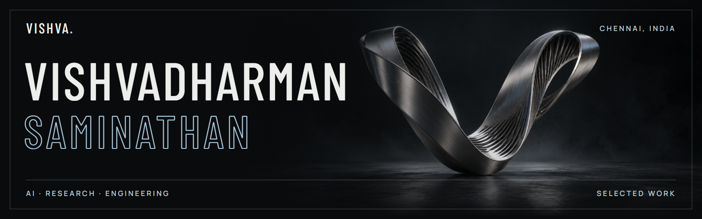

[Portfolio ↗](https://vishvadharman-portfolio.vercel.app/) · [LinkedIn ↗](https://www.linkedin.com/in/vishvasami23/) · [Email](mailto:vishvadharmansaminathan@gmail.com)

I'm in my final year of B.Tech in AI and ML at **VIT Chennai**. As an AI intern at **Mavdero TechServices**, I work on document comparison and spend a lot of time on what happens after the model flags a change. Can a reviewer trace it back to the source?

## Selected work

**[DeviationAI](https://deviation-ai-review.vercel.app/)** · Document AI\
Compares legal drafts against a reference and links each finding to the source wording.

**[HippocampAI / BrainVault](https://github.com/Vishvadharman/Hippocamp-AI)** · SanDisk Hackathon runner-up\
We extended the open-source memory engine with encrypted storage on a USB drive so an assistant could pick up its context on another machine.

**[KavachFusion](https://vishvadharman-portfolio.vercel.app/#work)** · Ongoing research\
Connects CAN bus alerts with vehicle-network trust scores.

**[Wall Crack Detection](https://github.com/Vishvadharman/Wall_Crack_Detection)** · Computer vision\
A ResNet-18 image classifier built with PyTorch.

## Research & inventions

**[Federated learning for V2X accident detection](https://doi.org/10.32604/cmes.2026.086802)** · First author · *Computer Modeling in Engineering & Sciences*, 2026

We used SUMO traffic simulations to test how a shared accident detector responds when attackers introduce fake vehicle identities or poison updates sent to the federated model.

Two other papers were accepted. One models cardiac electrophysiology with physics-informed networks (**IEEE TENCON 2026**), and the other uses audio to support emergency dispatch (**ICRTAC 2025**). I'm a co-inventor on two published Indian patent applications, **IN202641083839 A1** and **IN202641086137 A1**. [Research notes ↗](https://vishvadharman-portfolio.vercel.app/#research)

## Open source

I joined **GirlScript Summer of Code** in 2026. I [tested CommitPulse's streak calculation](https://github.com/JhaSourav07/commitpulse/pull/1853) against a large spike in one day's commits and [added parser coverage for SecuScan's URL fuzzer](https://github.com/utksh1/SecuScan/pull/779).

**Tools I reach for** · Python, PyTorch, FastAPI, Next.js, Redis, Qdrant, Docker
